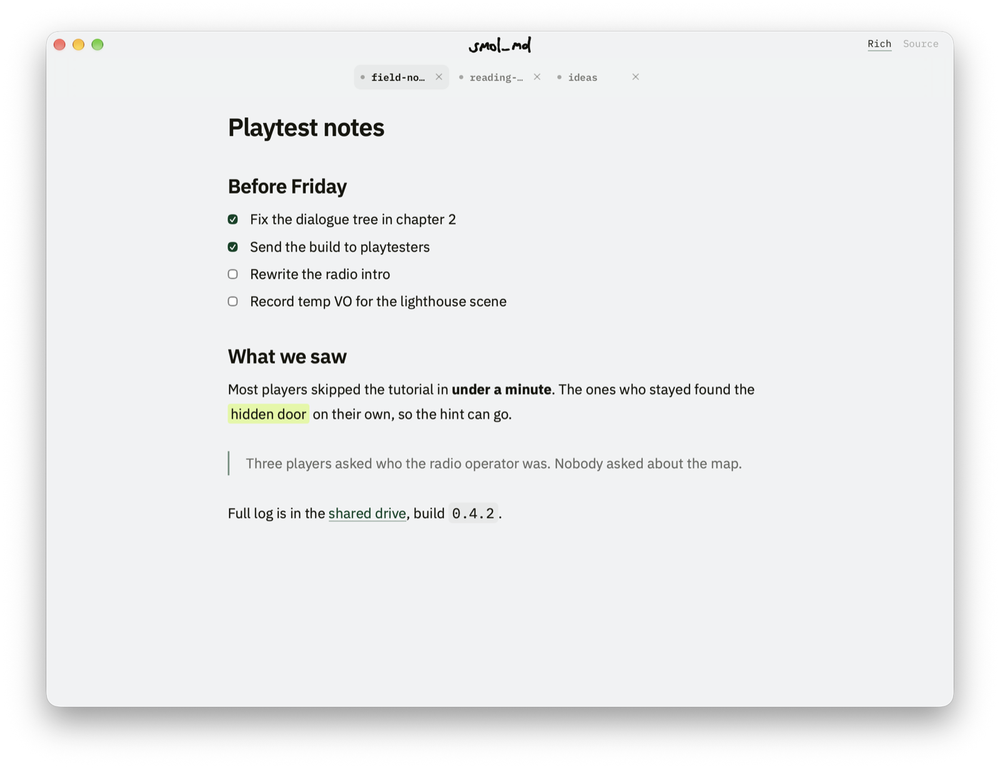
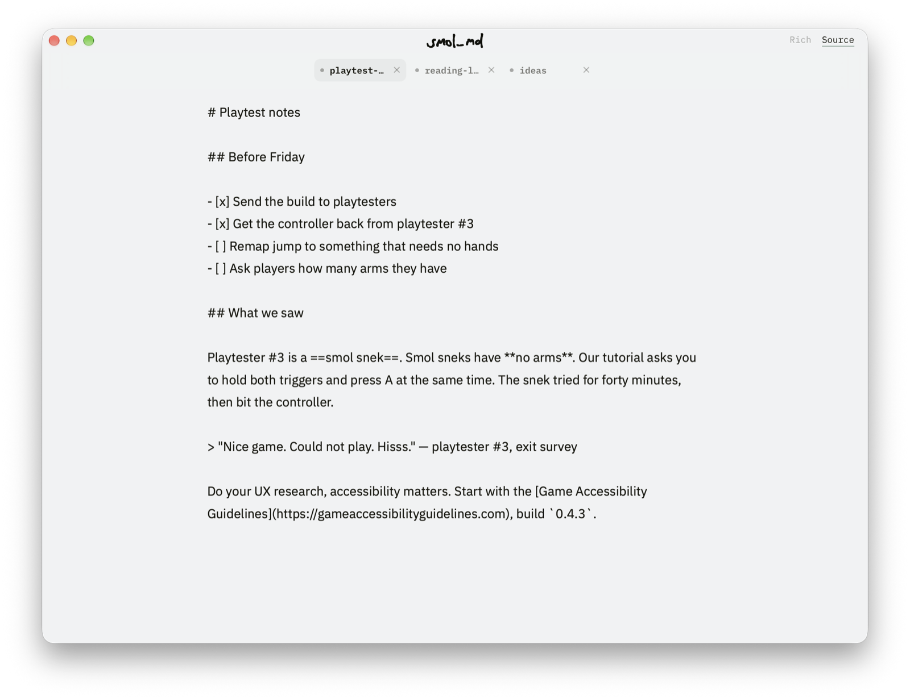

# smol_md

A smol markdown editor for macOS and Windows I vibecoded for myself. It's for those who, like me, like the minimalism of iA Writer and hate the markdown clutter.

## Download

[Latest release](https://github.com/billecart/smol_md/releases/latest): a `.dmg` for Apple Silicon Macs, an installer or an `.msi` for Windows. The Mac build is signed and notarised, so no "damaged" or "unidentified developer" warnings.

## What it does

- Rich and Source mode, two views of the same file;
- tabs;
- bold, italic, strikethrough, `==highlight==`, headings, lists, task lists, quotes, code and links — all in the right-click menu, some with shortcuts;
- hover a link to see where it goes, click it to open;
- find in both modes;
- mono, sans or serif, and zoom;
- print and export to PDF (macOS);
- asks before you lose anything, and a crash mid-save can't leave you with half a document.

It opens `.md` and `.markdown` files: double-click in Finder or Explorer, drop on the Dock icon on a Mac, or pick one from Open Recent.

## Shortcuts

`Cmd` on macOS, `Ctrl` on Windows.

| | |
|---|---|
| `Cmd+N` / `Cmd+O` | New, open |
| `Cmd+S` / `Cmd+Shift+S` | Save, save as |
| `` Cmd+` `` | Rich ↔ Source |
| `Cmd+F` | Find |
| `Cmd+W` / `Cmd+Shift+W` | Close tab, close window |
| `Ctrl+Tab` / `Cmd+Shift+]` | Next tab |
| `Ctrl+Shift+Tab` / `Cmd+Shift+[` | Previous tab |
| `Cmd+B` / `Cmd+I` | Bold, italic |
| `Cmd+1` / `2` / `3` | Heading 1, 2, 3 |
| `Cmd+K` | Link |
| `Cmd+=` / `Cmd+-` / `Cmd+0` | Zoom in, out, reset |

## Known limitations

- No dark mode yet. The snek is sssaving up for sunglasses.
- Tables are best edited in Source mode.
- Files over a megabyte or two get sluggish: the whole document lives in the page.

Building it yourself, tests and signing: [docs/DEVELOPMENT.md](docs/DEVELOPMENT.md).

## License

[MIT](LICENSE)
